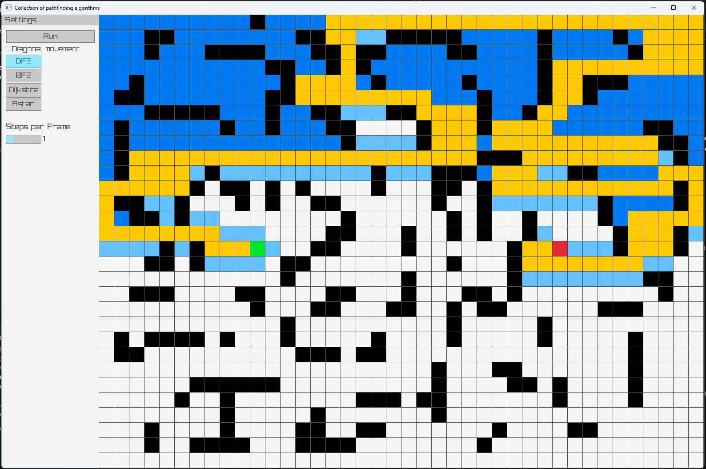
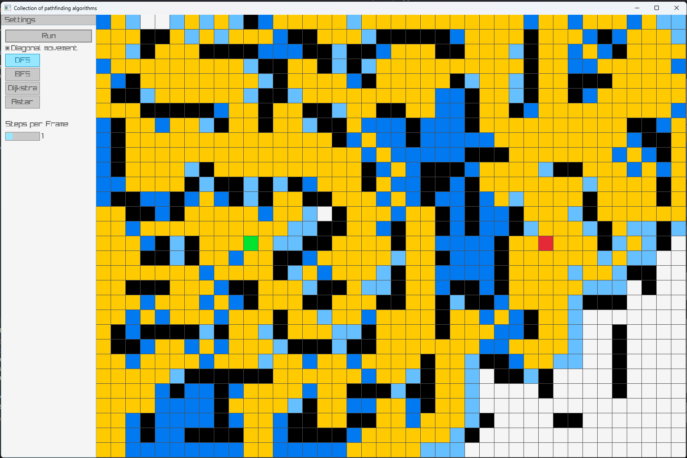
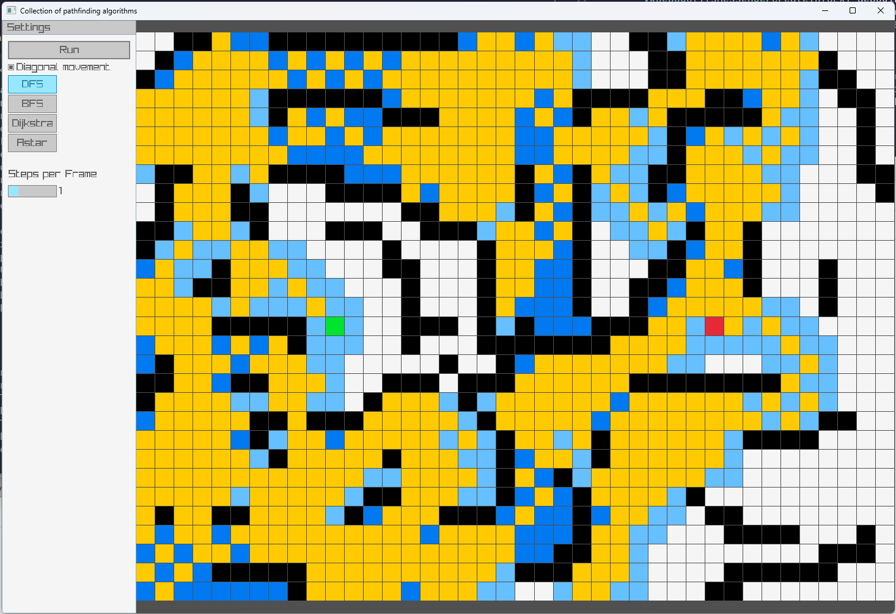
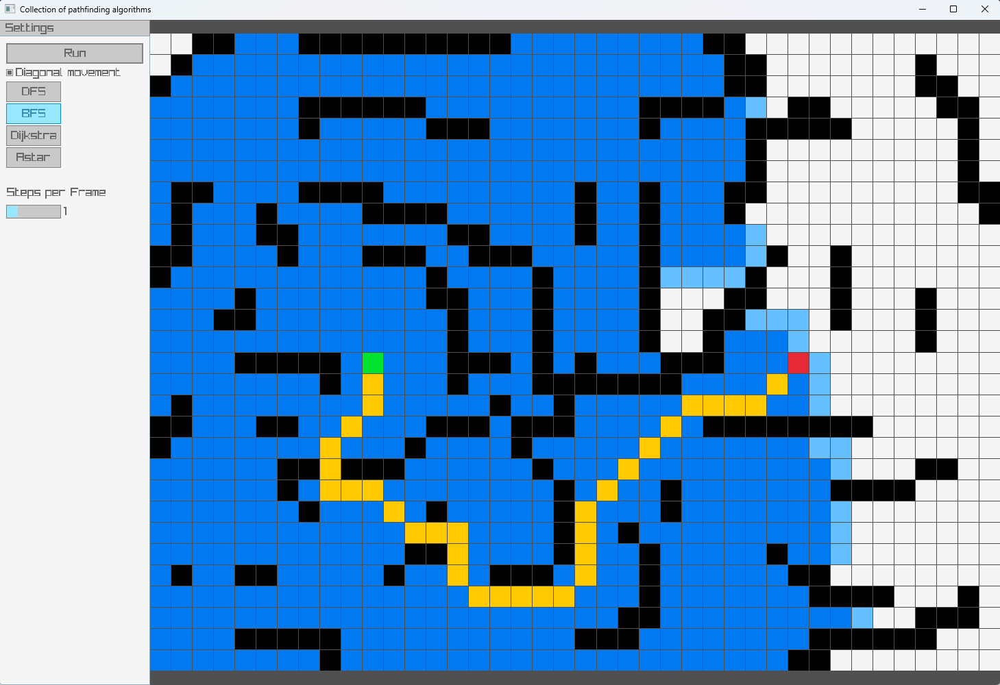
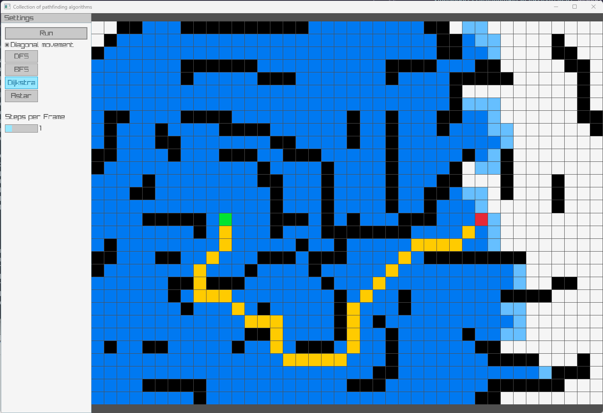
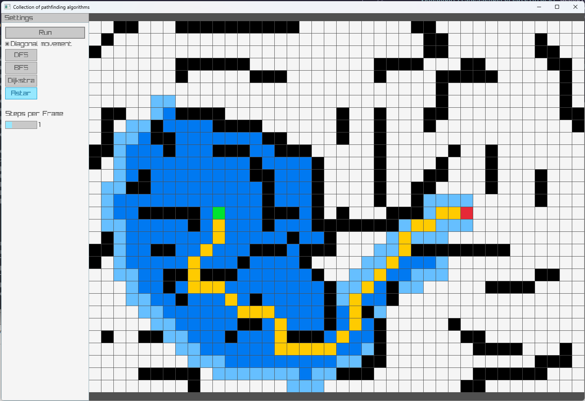

# Collection-of-pathfinding-algorithms
Small visualization application to visualize pathfinding algorithms

Requires CMake 3.28 or higher.
Compiler that supports C++23 features

Has only been tested with MSVC

### Bunch of different DFS:

### Bfs:

### Dijkstra:

### Astar:

